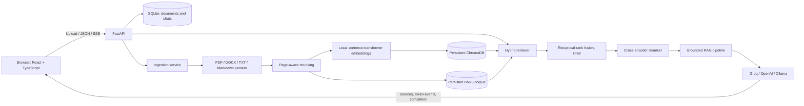

# DocMind

**A local-first document RAG app that answers questions with streamed, clickable citations to your files.**


To record the demo, start DocMind, upload one of the bundled sample documents, ask a question,
show the streamed answer, click its citation chip, and capture the source drawer with a screen
recorder. Save the GIF as `docs/assets/docmind-demo.gif` to replace this placeholder.

## Features

- Upload PDF, DOCX, TXT, and Markdown files (multiple files, up to 20 MB each).
- Background parsing, page-aware chunking, local embeddings, and upload-status polling.
- Hybrid vector and BM25 search, reciprocal-rank fusion, and cross-encoder reranking.
- Stream answers as Server-Sent Events with numbered source citations.
- Click a citation to inspect the exact retrieved passage, page, and relevance scores.
- Keep conversation history in SQLite; select which indexed documents each question searches.
- Grounding prompt treats document text as untrusted data and refuses unsupported questions with
  **“I couldn't find this in your documents.”**
- Retrieval-debug panel, responsive layout, drag-and-drop upload, and light/dark themes.
- Groq, OpenAI, and Ollama provider adapters; embeddings and reranking run locally.

## Architecture



See [docs/architecture.md](docs/architecture.md) for the architecture notes and request lifecycle.

## Tech stack

| Area | Technologies |
|---|---|
| Backend | Python 3.11, FastAPI, Pydantic v2, Uvicorn |
| LLM | Groq by default; provider interface for OpenAI and Ollama |
| Embeddings | sentence-transformers, `BAAI/bge-small-en-v1.5` |
| Vector search | ChromaDB, persistent local collection |
| Keyword search | `rank_bm25`, JSON-persisted chunk corpus |
| Reranking | `cross-encoder/ms-marco-MiniLM-L-6-v2` |
| Metadata and chat | SQLite, SQLAlchemy |
| Parsing | pypdf, python-docx |
| Frontend | React, TypeScript, Vite, Tailwind CSS, React Markdown |
| Tests and CI | pytest, Ruff, Vitest, GitHub Actions |
| Packaging | Docker, Docker Compose, Nginx |

## Quick start

### Docker Compose

From the project root, copy the example configuration and add your Groq key to the local
`.env` file. Do not commit `.env`; it is ignored by Git.

```powershell
Copy-Item .env.example .env
# Edit .env locally and set GROQ_API_KEY.
docker compose up --build
```

Open [http://localhost:8080](http://localhost:8080). The API is also available at
[http://localhost:8000](http://localhost:8000), with health at `/api/health`.
Uploaded files, SQLite, ChromaDB, and the BM25 index persist under the project `data/` folder.

### Manual setup on Windows

Use Python 3.11 and Node.js 20. Make `.env` as above, then open two terminals from the project
root.

**Terminal 1 — backend**

```powershell
py -3.11 -m venv .venv
.\.venv\Scripts\Activate.ps1
python -m pip install -r backend\requirements.txt
Set-Location backend
python -m uvicorn app.main:app --reload
```

**Terminal 2 — frontend**

```powershell
Set-Location frontend
npm ci
npm run dev
```

Open [http://localhost:5173](http://localhost:5173). The Vite development server proxies API
requests to `http://localhost:8000`. When started from `backend/`, the default `DATA_DIR=data`
resolves to `backend/data`; set `DATA_DIR=../data` in `.env` if you prefer the project-root
`data/` folder.

The first ingestion loads and downloads the embedding and reranker models if they are not already
cached. The backend logs this on startup; subsequent runs use the local model cache. Groq is
required for generated answers and the LLM-judged evaluation; local embeddings and retrieval
work without an LLM key.

### Run the checks

```powershell
Set-Location backend
ruff check app tests eval
python -m pytest -q

Set-Location ..\frontend
npm run lint
npm test
npm run build
```

## Configuration

Copy `.env.example` to `.env`. Never put keys in source files or commit `.env`.

| Variable | Default | Description |
|---|---|---|
| `GROQ_API_KEY` | empty | Groq API key; required when `LLM_PROVIDER=groq` |
| `LLM_PROVIDER` | `groq` | `groq`, `openai`, or `ollama` |
| `LLM_MODEL` | `openai/gpt-oss-120b` | Model ID supported by the selected provider |
| `OPENAI_API_KEY` | empty | Required when `LLM_PROVIDER=openai` |
| `OLLAMA_BASE_URL` | `http://localhost:11434` | Ollama server URL |
| `EMBEDDING_MODEL` | `BAAI/bge-small-en-v1.5` | Local sentence-transformer embedding model |
| `RERANKER_MODEL` | `cross-encoder/ms-marco-MiniLM-L-6-v2` | Local cross-encoder model |
| `CHUNK_SIZE` | `800` | Target chunk size in characters |
| `CHUNK_OVERLAP` | `150` | Chunk overlap in characters |
| `TOP_K` | `5` | Number of reranked passages used as answer context |
| `DATA_DIR` | `data` | Directory for database, vectors, BM25 data, and uploads |
| `CORS_ORIGINS` | `http://localhost:5173` | Comma-separated allowed browser origins |

**Groq model availability:** the requested `llama-3.3-70b-versatile` returned `model_not_found`
from Groq during this build. The working default is therefore `openai/gpt-oss-120b`, which was
confirmed available and used for the live chat and evaluation. Set `LLM_MODEL` to another model
ID available to your provider if needed.

## API

All routes are prefixed with `/api`.

| Method | Route | Description |
|---|---|---|
| `GET` | `/health` | API health and configured provider/model |
| `POST` | `/documents` | Multipart upload (`files`, multiple accepted); returns `202` with ingestion status |
| `GET` | `/documents` | List documents and poll ingestion status |
| `DELETE` | `/documents/{document_id}` | Delete original upload, vectors, BM25 entries, and metadata |
| `POST` | `/chat` | Stream a grounded answer as Server-Sent Events |
| `GET` | `/conversations` | List conversation summaries |
| `GET` | `/conversations/{conversation_id}/messages` | Fetch a conversation's messages and citations |
| `DELETE` | `/conversations/{conversation_id}` | Delete a conversation and its messages |

Example chat request:

```json
{
  "question": "How much is adult admission at the maritime museum?",
  "document_ids": ["<document-id>"],
  "conversation_id": null
}
```

The SSE response emits a `sources` event first (citation snippets and retrieval scores), then
`token` events, followed by `done` with the conversation ID. An `error` event is sent for stream
failures. Omit `document_ids` or pass an empty list to search all indexed files.

## How retrieval works

For each standalone question, DocMind searches two indexes in parallel: the embedding index finds
semantically similar passages, while BM25 finds passages that share important words with the
question. It takes up to 20 results from each, merges their rankings using reciprocal-rank fusion
(`1 / (60 + rank)` per list), then uses a cross-encoder to score each candidate against the full
question. The top five passages become the answer context.

If a question follows earlier chat turns, one LLM call rewrites it into a standalone question.
The answer prompt treats retrieved text as evidence rather than instructions, requires inline
citations matching the source list, and instructs the model to refuse when that evidence is
insufficient. Chroma's anonymized telemetry is disabled; uploaded documents and indexes stay in
the configured local data directory.

## Evaluation

Run the evaluation from `backend/` after configuring an available LLM provider:

```powershell
python eval/run_eval.py
```

The script ingests the three bundled sample documents, evaluates 10 question/source pairs, compares
vector-only, BM25-only, and hybrid-plus-reranking retrieval using Hit@5 and MRR, and uses the LLM
as a judge for hybrid answer faithfulness and relevance. It writes JSON and Markdown results to
[`backend/eval/results/`](backend/eval/results/).

Measured run (10 bundled questions, Groq `openai/gpt-oss-120b` answer/judge model):

| Retrieval mode | Hit@5 | MRR |
|---|---:|---:|
| Vector only | 1.000 | 1.000 |
| BM25 only | 1.000 | 1.000 |
| Hybrid + rerank | 1.000 | 1.000 |

| Hybrid + rerank answer quality | Score |
|---|---:|
| LLM-judged faithfulness | 1.000 |
| LLM-judged answer relevance | 1.000 |

These are actual results from the small bundled dataset, not a general benchmark; the LLM judge
scores its own provider's answers and should be interpreted accordingly. See the complete output
in [`backend/eval/results/results.md`](backend/eval/results/results.md).

## Project structure

```text
backend/
  app/
    main.py                 # FastAPI app, middleware, error handling
    config.py               # Environment settings
    db.py                   # SQLite models and sessions
    routers/                # Health, document, and chat APIs
    services/
      chunking.py           # Page-aware recursive chunking
      ingestion.py          # Parsing, indexing, and background ingestion
      embeddings.py         # Local embeddings
      vectorstore.py        # Persistent ChromaDB wrapper
      bm25_index.py         # Persistent keyword index
      retriever.py          # Hybrid retrieval and RRF
      reranker.py           # Cross-encoder ranking
      rag_pipeline.py       # Rewrite, context, citations, and streaming
      llm/                  # Groq, OpenAI, and Ollama providers
  eval/                     # Dataset, runner, and measured results
  tests/                    # Chunking, retrieval, pipeline, and API tests
frontend/
  src/
    api/                    # Typed HTTP and SSE client
    components/             # Markdown with clickable citations
    hooks/                  # Streaming chat hook
sample_docs/                # Self-authored demo and evaluation corpus
docs/architecture.md        # Detailed architecture diagram and lifecycle
.github/workflows/ci.yml    # Backend and frontend checks
docker-compose.yml
.env.example
```

## Limitations and future work

- No user authentication or multi-user data isolation; intended for a trusted, single-user local
  workspace.
- Scanned PDFs need OCR; the current PDF parser extracts embedded text only.
- Tables and complex document layouts are not reconstructed as structured data.
- The evaluation corpus is intentionally small; add domain-specific and adversarial examples before
  relying on scores for production decisions.
- Future improvements: multi-user authentication, OCR for scanned PDFs, and robust table extraction.

## License

MIT. See [LICENSE](LICENSE).
