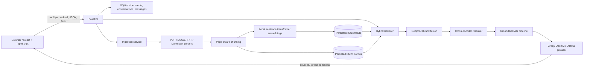

# DocMind architecture

## Request lifecycle

1. The upload endpoint validates supported extensions and a 20 MB per-file limit, persists
   each original file, and schedules ingestion in a background task.
2. The ingestion service extracts page text, splits at paragraph and sentence boundaries,
   computes normalized local embeddings, and stores chunks in ChromaDB and the JSON-backed
   BM25 corpus. SQLite tracks the upload and its status.
3. Chat history is used to rewrite a follow-up question into a standalone query when needed.
   Vector and BM25 rankings are combined with reciprocal-rank fusion (`k=60`), then the
   cross-encoder reranks the candidates.
4. The stream begins with retrieved source metadata, followed by answer token events and a
   completion event. The system prompt treats document text as untrusted evidence, not
   instructions, and requires grounded inline citations.

The local `data/` directory contains the SQLite database, Chroma persistence, keyword index,
and original uploads. It is intentionally excluded from version control.
